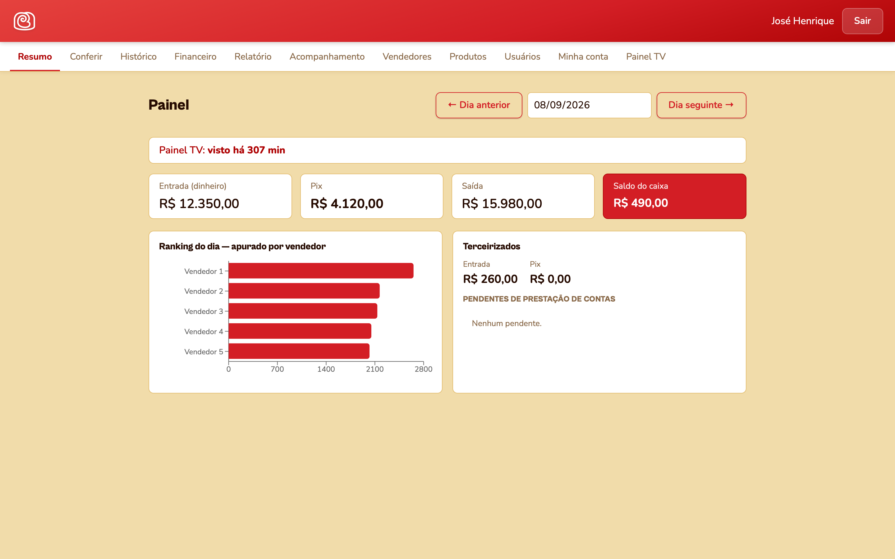
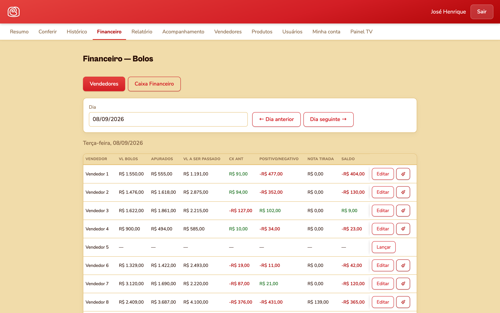

# Bakery Consignment System

Management system for **Ceará Bolos**, a bakery that sells through a team of street vendors. Each vendor takes cakes on consignment, and the system tracks what they took, returned and discarded, and closes the account with the finance team.

**Live:** [cearabolos.com.br](https://cearabolos.com.br)

| Daily dashboard | Vendor account settlement |
|---|---|
|  |  |

*Vendor names and amounts in the screenshots were replaced with placeholders.*

## Features

- **Consignment control:** what each vendor took, returned and discarded, per day.
- **Check-in screen:** the finance team reviews each vendor and marks them as done.
- **TV queue panel:** a public screen (token-protected) shown on a TV that calls vendors in FIFO order and refreshes on its own.
- **Weekly cash:** weekly cash report with carried-over balance, fuel and tire expenses.
- **History:** monthly view with total discards for the period.
- **Mobile first:** bottom navigation bar on phones, since vendors use it on the go.
- Role-based access (admin vs. staff).

## Stack

- **Frontend:** React, Vite
- **Backend:** Node.js, Express, JWT
- **Database:** Supabase (PostgreSQL), including SQL functions for reports
- **Infra:** Docker on a Linux VPS, deploy script with rsync + docker compose, Cloudflare

---

**About the code:** this is a client project, so the source code is private. This repository documents what was built and how. I am happy to walk through the code and architecture in a call.

Built by [José Henrique Rodrigues](https://www.linkedin.com/in/josehenriquerodrigues-dev) · SmartHelp LTDA
